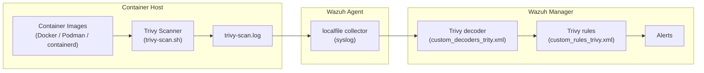

# wazuh-trivy Architecture Overview

This document describes how `wazuh-trivy` scans container images for vulnerabilities and how the results flow into the Wazuh security platform.

## What It Does

`wazuh-trivy` uses [Trivy](https://trivy.dev/) to scan container images for known vulnerabilities (CVEs). The scan results are written to a log file that the Wazuh agent monitors. Wazuh decodes each line, applies severity-based rules, and raises alerts in the Wazuh SIEM.

## Data Flow

### Step-by-Step

1. **Scan**: The `trivy-scan.sh` script (run as a Wazuh wodle command) detects the container engine (Docker, Podman, or containerd), lists the local container images, and runs a Trivy scan on each.

2. **Format**: Trivy output is formatted with a custom template that extracts `Package`, `Version Installed`, `Vulnerability ID`, and `Severity` for each vulnerability.

3. **Log**: The formatted results are appended to `trivy-scan.log` (`/var/ossec/logs/trivy-scan.log` on Linux, `/Library/Ossec/logs/trivy-scan.log` on macOS).

4. **Collect**: The Wazuh agent monitors the log file via a `<localfile>` entry with `log_format syslog` and forwards the events to the manager.

5. **Decode**: On the Wazuh manager, the custom decoder (`custom_decoders_trity.xml`) parses each log line into fields: `image`, `package`, `version`, `vulnerability_id`, and `severity`.

6. **Alert**: On the Wazuh manager, the custom rules (`custom_rules_trivy.xml`) assign a severity level to each vulnerability and raise an alert.

## Severity Mapping

| Severity | Rule ID | Level |
| :--- | :--- | :--- |
| Critical | 100102 | 14 |
| High | 100103 | 12 |
| Medium | 100104 | 7 |
| Low | 100105 | 4 |
| Negligible | 100106 | 1 |

## Scheduling

The scan runs on a schedule defined by the Wazuh wodle command in the agent configuration:

- Interval: `12h`
- Run on start: `yes`
- Timeout: `0` (no timeout)

## Components

| Component | Location | Role |
| :--- | :--- | :--- |
| Install script (Linux) | `scripts/linux/install.sh` | Installs Trivy and configures the Wazuh agent |
| Install script (macOS) | `scripts/macos/install.sh` | Installs Trivy and configures the Wazuh agent |
| Scan script (Linux) | `scripts/linux/trivy-scan.sh` | Runs the Trivy scan and writes the log |
| Scan script (macOS) | `scripts/macos/trivy-scan.sh` | Runs the Trivy scan and writes the log |
| Decoder | `config/custom_decoders_trity.xml` | Parses Trivy log lines |
| Rules | `config/custom_rules_trivy.xml` | Assigns severity and raises alerts |
